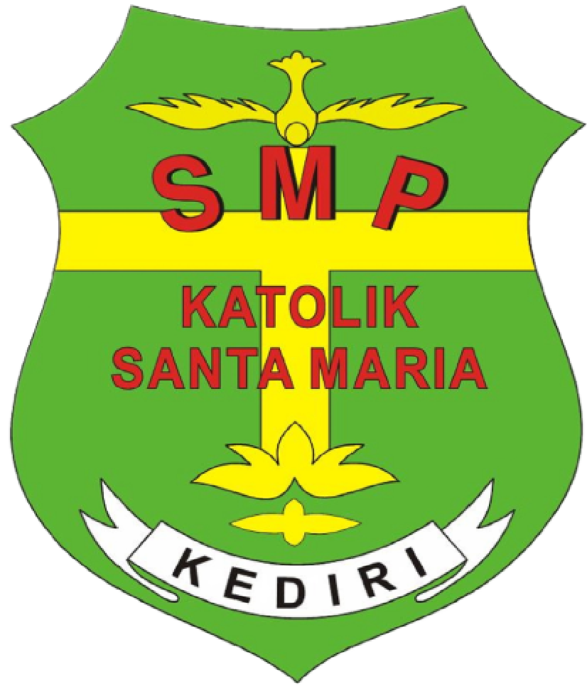

# SMP Katolik Santa Maria Kediri

<p align="center">
  
</p>

<p align="center">
  <strong>Cerdas, Terampil, dan Berkarakter</strong><br>
  Website profil dan informasi resmi SMP Katolik Santa Maria Kediri.
</p>

<p align="center">
  <a href="https://github.com/robertusdanan/smpksantamakediri">Repository</a> ·
  <a href="https://forms.gle/D3ag11deP443nD2i6">PPDB Online</a> ·
  <a href="https://www.instagram.com/smpk_sanmar_kediri/">Instagram</a>
</p>

---

## Tentang Website

Website ini menjadi ruang digital SMP Katolik Santa Maria Kediri untuk memperkenalkan identitas sekolah, lingkungan belajar, fasilitas, kegiatan, berita, pengumuman, dan informasi Penerimaan Peserta Didik Baru.

Konten disusun dengan semangat pendidikan Vinsensian: mendampingi setiap siswa agar bertumbuh dalam ilmu, keterampilan, karakter, dan kepedulian.

> Terwujudnya insan pendidikan yang cerdas, berwawasan global, kompetitif, berkarakter Pancasila, yang berlandaskan semangat Vinsensian.

## Fitur

- Halaman beranda dengan ringkasan identitas dan keunggulan sekolah
- Informasi fasilitas sekolah
- Arsip kegiatan berdasarkan tahun
- Artikel dan cerita sekolah
- Daftar pengumuman akademik dan umum
- Informasi PPDB Online dan alur pendaftaran
- Tombol komunikasi langsung melalui WhatsApp
- Tautan media sosial sekolah
- Tampilan responsif untuk desktop dan perangkat mobile
- Data konten terpusat tanpa ketergantungan database

## Teknologi

- **PHP 8+** — server-side rendering
- **HTML5** — struktur halaman semantik
- **CSS3** — layout responsif dan visual system
- **JavaScript** — interaksi antarmuka ringan
- **SVG dan PNG** — aset visual sekolah

Tidak ada framework atau package manager. Website dapat dijalankan dengan PHP built-in server.

## Struktur Project

```text
.
├── assets/
│   ├── css/style.css       # Gaya visual dan responsive layout
│   ├── img/                # Logo dan aset gambar
│   └── js/main.js          # Interaksi antarmuka
├── includes/
│   ├── data.php            # Data sekolah, navigasi, konten, dan helper
│   ├── footer.php          # Footer bersama
│   └── header.php          # Header dan navigasi bersama
├── index.php               # Beranda
├── fasilitas.php           # Fasilitas sekolah
├── kegiatan.php            # Daftar kegiatan
├── berita.php              # Artikel dan cerita sekolah
├── pengumuman.php          # Pengumuman sekolah
├── ppdb.php                # Informasi PPDB Online
└── README.md
```

## Menjalankan Secara Lokal

### Prasyarat

- PHP 8.0 atau lebih baru
- Browser modern

### Langkah

```bash
git clone https://github.com/robertusdanan/smpksantamakediri.git
cd smpksantamakediri
php -S localhost:8000
```

Buka:

```text
http://localhost:8000
```

Untuk pemeriksaan sintaks seluruh file PHP:

```bash
find . -name '*.php' -print0 | xargs -0 -n1 php -l
```

## Mengubah Konten

Sebagian besar informasi website berada di:

```text
includes/data.php
```

File tersebut memuat:

- Nama, alamat, kontak, dan tautan media sosial
- Statistik sekolah
- Visi, keunggulan, mata pelajaran, dan ekstrakurikuler
- Fasilitas
- Kegiatan
- Berita
- Pengumuman
- Alur dan persyaratan PPDB

Perubahan aset visual dilakukan di:

```text
assets/css/style.css
assets/img/
assets/js/main.js
```

## Catatan Pengelolaan Data

Website saat ini menggunakan data statis berbasis PHP. Pendekatan ini menjaga deployment tetap sederhana dan cepat untuk konten yang jarang berubah.

Jika nantinya diperlukan pengelolaan konten oleh banyak pengguna, autentikasi admin, histori perubahan, atau unggah berita melalui dashboard, data dapat dipindahkan ke CMS atau database tanpa mengubah struktur halaman publik secara besar.

## Deployment

Website dapat ditempatkan pada hosting PHP biasa dengan document root mengarah ke folder project. Pastikan:

1. PHP 8+ tersedia.
2. Semua file project terunggah.
3. Permission file dapat dibaca web server.
4. URL formulir PPDB, WhatsApp, dan media sosial sudah benar.
5. Konten `includes/data.php` sudah diperiksa sebelum dipublikasikan.

## Identitas Sekolah

**SMP Katolik Santa Maria Kediri**  
Jl. Brawijaya No. 63, Pakelan, Kec. Kota, Kota Kediri, Jawa Timur 64129  
Telepon: `(0354) 687084`  
Email: `smpksantamariakdr@yahoo.com`

---

<p align="center">
  Dibangun untuk mendukung karya pendidikan SMP Katolik Santa Maria Kediri.
</p>
